# Домашнее задание к занятию «Сетевое взаимодействие в Kubernetes» - Петр Петров

### Задание 1: Настройка Service (ClusterIP и NodePort)
### Задача
Развернуть приложение из двух контейнеров (nginx и multitool) и обеспечить доступ к ним:

- Внутри кластера через ClusterIP.
- Снаружи через NodePort.

### Шаги выполнения
1. Создать Deployment с двумя контейнерами:
- nginx (порт 80).
- multitool (порт 8080).
- Количество реплик: 3.

2. Создать Service типа ClusterIP, который:
- Открывает nginx на порту 9001.
- Открывает multitool на порту 9002.

3. Проверить доступность изнутри кластера:

```
kubectl run test-pod --image=wbitt/network-multitool --rm -it -- sh
 curl <service-name>:9001 # Проверить nginx
 curl <service-name>:9002 # Проверить multitool
```

4. Создать Service типа NodePort для доступа к nginx снаружи.

5. Проверить доступ с локального компьютера:
 `curl <node-ip>:<node-port>`

### Что сдать на проверку
Манифесты:
- deployment-multi-container.yaml
- service-clusterip.yaml
- service-nodeport.yaml
Скриншоты проверки доступа (curl или браузер).

### Задание2: Настройка Ingress

### Задача
Развернуть два приложения (frontend и backend) и обеспечить доступ к ним через Ingress по разным путям.

### Шаги выполнения

1. Развернуть два Deployment:
- frontend (образ nginx).
- backend (образ wbitt/network-multitool).
2. Создать Service для каждого приложения.
3. Включить Ingress-контроллер:

`microk8s enable ingress`

4. Создать Ingress, который:
- Открывает frontend по пути /.
- Открывает backend по пути /api.

5. Проверить доступность:
 ```
curl <host>/
curl <host>/api
```
или через браузер.

### Что сдать на проверку
Манифесты:
- deployment-frontend.yaml
- deployment-backend.yaml
- service-frontend.yaml
- service-backend.yaml
- ingress.yaml
Скриншоты проверки доступа (curl или браузер).

### Решение 1

Deployment multi-container-app развёрнут с тремя репликами. Каждый Pod содержит два контейнера: nginx и multitool. Проверено состояние Deployment и Pod, а также доступность веб-интерфейса Network MultiTool.

[deployment-multi-container.yaml](deployment-multi-container.yaml)

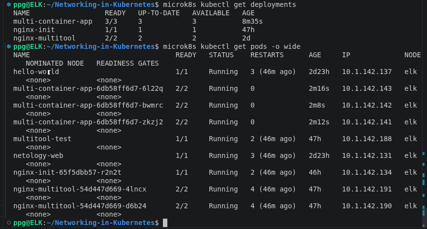

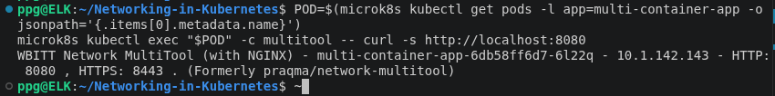

Создан сервис multi-container-service типа ClusterIP для внутреннего доступа к приложениям в Kubernetes. Сервис направляет запросы на порт 9001 к nginx (порт 80), а на порт 9002 — к Network MultiTool (порт 8080). Проверены конечные точки (Endpoints) всех трёх реплик и доступность приложений через DNS-имя сервиса.

[service-clusterip.yaml](service-clusterip.yaml)

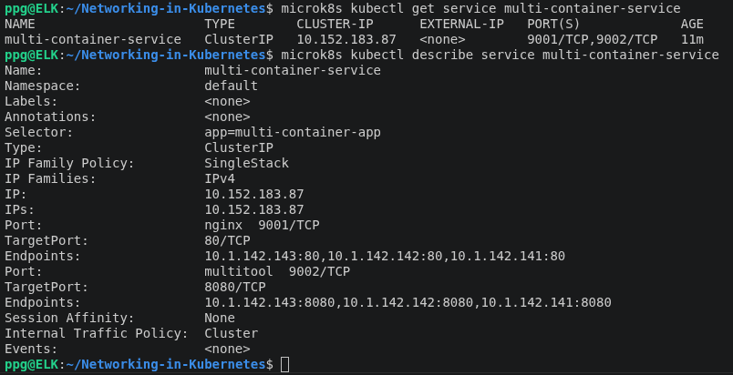

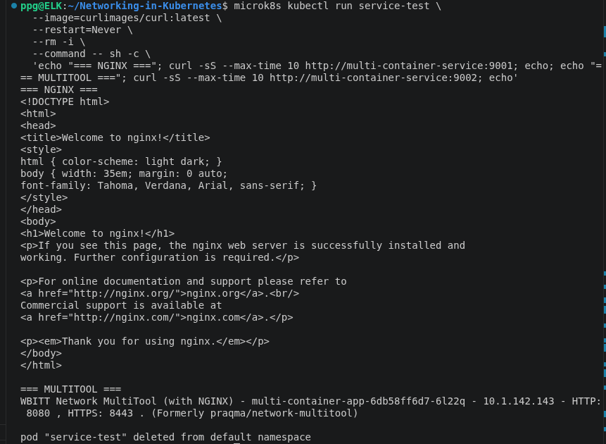

Создан сервис multi-container-nodeport типа NodePort для доступа к nginx через порт 30080 узла Kubernetes. Сервис направляет запросы на порт 80 контейнера nginx.

[service-nodeport.yaml](service-nodeport.yaml)

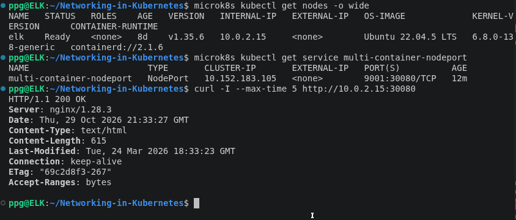

Настроен проброс порта VirtualBox с хостовой операционной системы Windows на виртуальную машину Ubuntu. Проверен доступ к nginx через NodePort Kubernetes по адресу http://127.0.0.1:30080. В браузере отображается стандартная страница nginx.

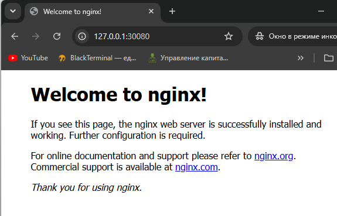

### Решение 2:

Созданы два Deployment: frontend на основе nginx и backend на основе Network MultiTool. Для каждого приложения создан отдельный Pod. Проверено успешное состояние Deployment и готовность контейнеров.

[deployment-frontend.yaml](task2/deployment-frontend.yaml)
[deployment-backend.yaml](task2/deployment-backend.yaml)


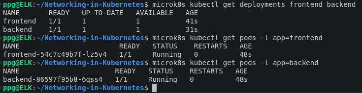

Созданы Service типа ClusterIP для frontend и backend. Проверка IP-адресов и конечных точек Endpoints.

[service-frontend.yaml](task2/service-frontend.yaml)
[service-backend.yaml](task2/service-backend.yaml)


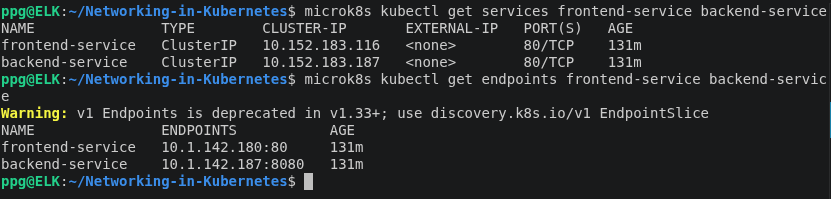

Установка и запуск Ingress Controller Traefik в MicroK8s. Проверка состояния контроллера и доступных портов HTTP/HTTPS

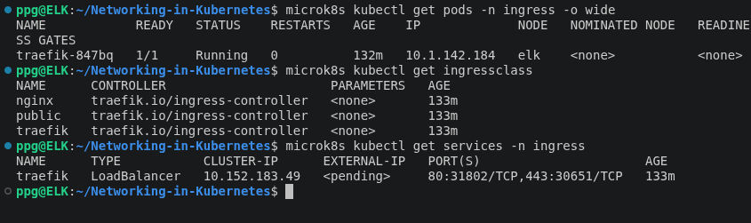

Создание правил Ingress для маршрутизации HTTP-запросов к frontend и backend. Настройка Middleware Traefik для удаления префикса /api

 [ingress.yaml](task2/ingress.yaml)

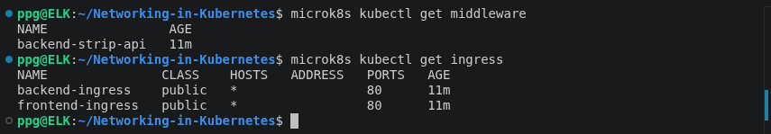

Проверка маршрутизации HTTP-запросов через Ingress Controller. Frontend и backend успешно возвращают HTTP 200 OK.

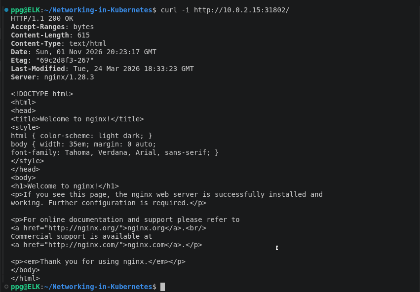

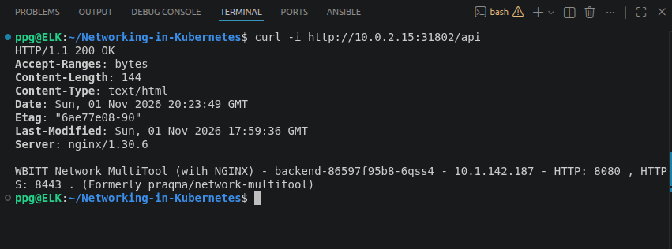

Проверка доступности frontend через Ingress из браузера Windows

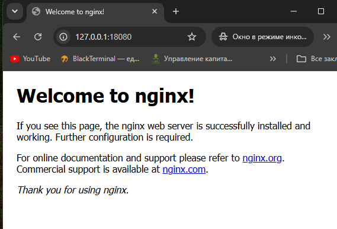

Проверка доступности backend через Ingress из браузера Windows

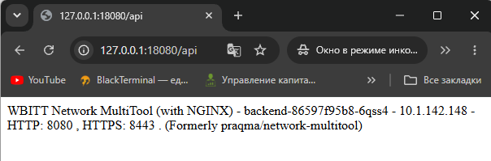

